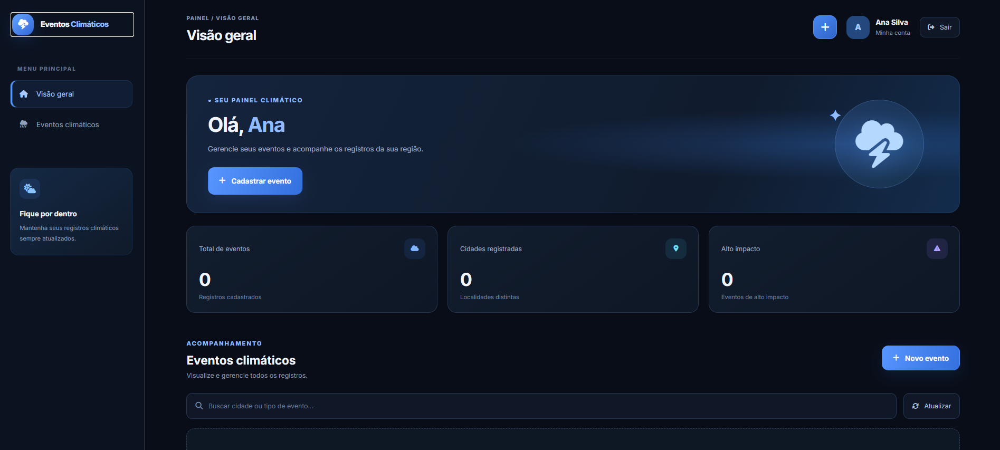
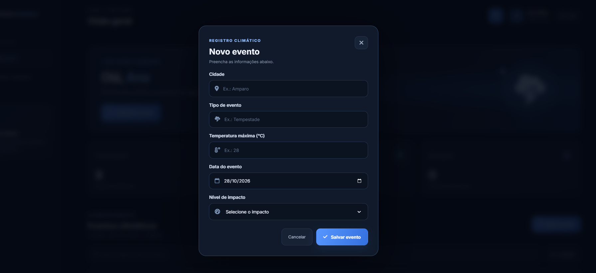
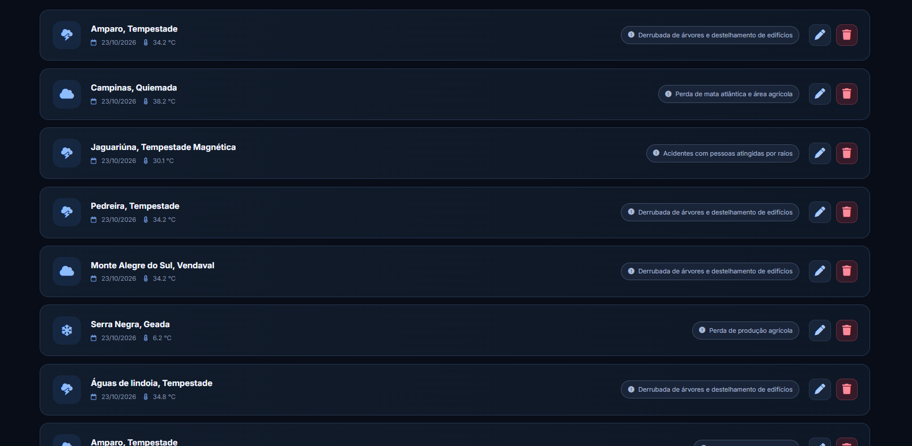

#  Eventos Climáticos

##  Sobre o projeto

O **Eventos Climáticos** é um sistema desenvolvido para registrar e gerenciar eventos climáticos extremos em diferentes cidades. O projeto foi desenvolvido como parte das atividades do curso Técnico em Desenvolvimento de Sistemas do SENAI.

A aplicação permite realizar login, visualizar o usuário conectado e gerenciar registros de eventos climáticos por meio de uma interface integrada a uma API e a um banco de dados relacional.

##  Objetivo

Desenvolver uma aplicação Full Stack para cadastrar, consultar, atualizar e excluir eventos climáticos, utilizando tecnologias de desenvolvimento web e banco de dados.

##  Tecnologias utilizadas

- HTML5
- CSS3
- JavaScript
- Node.js
- Express
- Prisma ORM
- MySQL / MariaDB
- Insomnia
- Git e GitHub

##  Funcionalidades

###  Login
- Tela de login para os usuários cadastrados.
- Validação das credenciais por meio do back-end.
- Retorno dos dados do usuário.

###  Página inicial
- Exibição do nome do usuário logado.
- Botão para sair do sistema.
- Acesso ao gerenciamento de eventos climáticos.

###  Gerenciamento de eventos climáticos
- Cadastro de novos eventos.
- Listagem dos eventos registrados.
- Consulta de eventos específicos.
- Edição das informações cadastradas.
- Exclusão de registros.

##  Demonstração do sistema

Nesta seção serão apresentadas imagens das páginas desenvolvidas para o sistema Eventos Climáticos.

### 1. Página de Login

Tela responsável pelo acesso dos usuários ao sistema.


### 2. Página Inicial — Home

Página principal que apresenta o nome do usuário conectado e as funcionalidades do sistema.



### 3. Página de Cadastro de Eventos

Formulário utilizado para cadastrar eventos climáticos, informando cidade, tipo de evento, temperatura máxima e nível de impacto.



### 4. Página de Listagem de Eventos

Página destinada à visualização dos eventos climáticos registrados no banco de dados.




## Banco de dados

O projeto utiliza o banco de dados `eventos`, com duas tabelas principais.

### Tabela Usuario

- `id`: identificador do usuário.
- `nome`: nome completo.
- `email`: e-mail único.
- `senha`: senha utilizada no acesso.
- `eventos`: relacionamento com os eventos cadastrados.

### Tabela Evento

- `id`: identificador do evento.
- `usuarioId`: usuário responsável pelo registro.
- `cidade`: cidade onde ocorreu o evento.
- `tipoEvento`: classificação do evento climático.
- `temperaturaMaxima`: temperatura máxima registrada, quando informada.
- `data`: data do registro.
- `nivelImpacto`: descrição dos impactos causados.

Um usuário pode possuir vários eventos climáticos cadastrados.

##  Como executar o projeto

### 1. Pré-requisitos

- Node.js instalado.
- MySQL ou MariaDB em execução.
- Visual Studio Code.
- Git instalado, caso deseje clonar o repositório.

### 2. Clonar o repositório

```bash
git clone URL_DO_REPOSITORIO
```

Entre na pasta do projeto e depois na pasta `api`.

### 3. Instalar as dependências

```bash
npm install
```

### 4. Configurar o arquivo `.env`

```env
PORT=3000
DATABASE_URL="mysql://root@localhost:3306/eventos"
```

Ajuste a conexão conforme a configuração do banco de dados utilizado.

### 5. Preparar o banco de dados

Execute os comandos no terminal dentro da pasta `api`.

```bash
npx prisma generate
npx prisma migrate dev --name init
npx prisma db seed
```

### 6. Iniciar o servidor

```bash
npm run dev
```

A API estará disponível em:

`http://localhost:3000`

### 7. Executar o front-end

Abra a pasta `web` no Visual Studio Code e execute a página de login utilizando a extensão Live Server.

## 📂 Estrutura do projeto

```text
eventos/
├── api/
│   ├── prisma/
│   │   ├── schema.prisma
│   │   ├── seed.js
│   │   └── migrations/
│   ├── src/
│   │   ├── controllers/
│   │   ├── routes/
│   │   └── data/
│   ├── .env
│   ├── .gitignore
│   ├── prisma.config.ts
│   ├── server.js
│   └── package.json
│
├── web/
│   ├── login.html
│   ├── home.html
│   ├── css/
│   └── js/
│
├── prints/
│   ├── tela-login.png
│   ├── tela-home.png
│   ├── cadastro-evento.png
│   ├── listagem-eventos.png
│   ├── editar-evento.png
│   └── excluir-evento.png
│
└── README.md
```

*Observação: a estrutura deve ser ajustada para corresponder aos arquivos reais do projeto.*

## Desenvolvedora

**Lívia Morais Pereira**

Curso Técnico em Desenvolvimento de Sistemas — SENAI.

## Informações acadêmicas

- **Atividade:** Aula 05 — Recursos Avançados: Prisma Seed.
- **Projeto:** Eventos Climáticos.
- **Tema:** Sistema para registro de eventos climáticos extremos.

---

Desenvolvido para fins educacionais como parte das atividades do curso Técnico em Desenvolvimento de Sistemas do SENAI.
